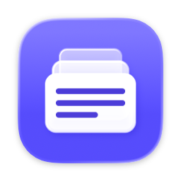
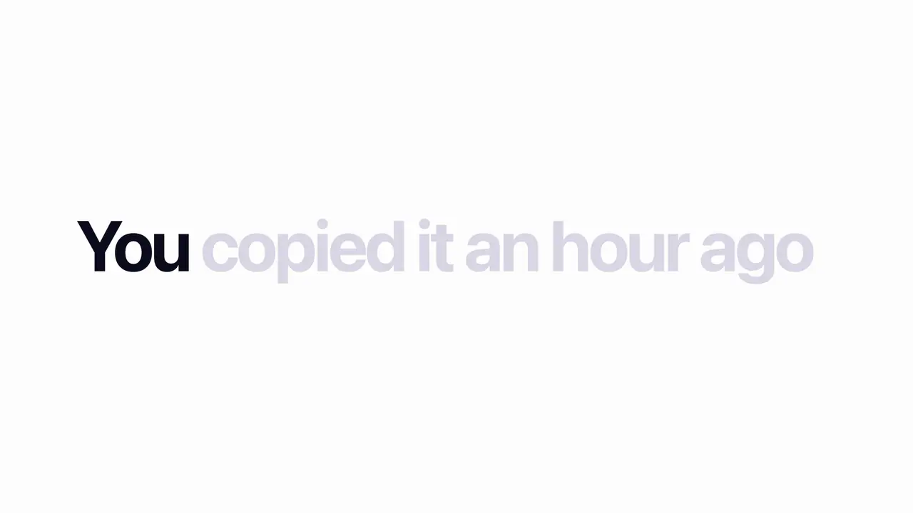

<p align="center">
  
</p>

<h1 align="center">Spare</h1>

<p align="center">
  <strong>Everything you copied, one keystroke away.</strong><br />
  A clipboard history for macOS that stays out of the way.
</p>

<p align="center">
  
  
  
  
</p>

<p align="center">
  <a href="readme/demo.mp4">
    
  </a>
  <br />
  <sub><a href="readme/demo.mp4">Watch with sound</a> · music: “Electro Dreams” by Arulo (Mixkit)</sub>
</p>

Press **⌘⇧V**, type a few letters of something you copied earlier, press Return, and it is pasted
where you were typing.

Text and images, pinned favourites, type filters. Swift and AppKit, no dependencies, under 1 MB of
code. Everything stays on your Mac.

## Install

Requires macOS 26 (Tahoe) or later, Apple silicon or Intel.

1. Download `Spare-<version>.dmg` and open it.
2. Drag **Spare** into **Applications**, then open it from there.
3. Spare isn't notarized by Apple, so macOS refuses it the first time. Open **System Settings ›
   Privacy & Security**, scroll down to the message about Spare and click **Open Anyway**. This
   is needed once per version.
4. The first time you paste from Spare, macOS asks for **Accessibility** access. Spare needs it
   to press ⌘V for you; without it, a chosen clip is copied and you paste it yourself.

Spare lives in the menu bar. To start it with your Mac, turn on **Launch at login** in Settings.

## Use

| Key | Does |
| --- | --- |
| ⌘⇧V | Open the palette (change it in Settings) |
| Type | Search: every word must match, in any order |
| ↑ ↓, Return | Choose, and paste it into the app you came from |
| ⌘1 … ⌘9 | Paste the first nine rows directly |
| ⌘P | Pin or unpin. Pinned clips stay at the top and are never trimmed |
| ⌘⌫ | Delete the selected clip; ⌘Z brings it back |
| ⌘C | Copy without pasting |
| ⌘F | Show only text, images, links or email addresses |
| Esc | Close |

Hold ⌘ for a moment and the palette shows these shortcuts. Searching "image", "link" or "pinned"
finds clips by kind as well as by content.

## Privacy

- History is stored only on this Mac, in `~/Library/Application Support/app.spare`. Spare makes
  no network connections.
- Copies that apps mark as concealed or transient are never recorded, including passwords from
  1Password, KeeWeb and other managers that follow the
  [nspasteboard.org](http://nspasteboard.org) convention.
- Clips older than a month are removed by default; Settings offers a week, three months or never.
  **Reset Database…** deletes everything.

## Uninstall

Quit Spare from its menu, drag it to the Trash, and delete
`~/Library/Application Support/app.spare` and `~/Library/Caches/app.spare`.

## Build from source

Needs Xcode 26 or later (for the Liquid Glass icon; the Command Line Tools alone build the app
with a generic icon).

```sh
Scripts/build-app.sh            # build/Debug/Spare Dev.app — its own bundle id, prefs and history
Scripts/build-app.sh Release    # build/Release/Spare.app, universal
Scripts/run-tests.sh            # every harness; the last one copies and pastes for real
```

`xcodegen generate` makes an Xcode project from `project.yml` if you prefer working in Xcode.

## Release

```sh
Scripts/build-dmg.sh
```

Writes `dist/Spare-<version>.dmg` and its SHA-256. The version lives in `project.yml`. With an
Apple Developer ID, set `SPARE_SIGN_IDENTITY` and `SPARE_NOTARY_PROFILE` and the same script
signs and notarizes it, so the Open Anyway step goes away (see the script's header).

## License

[GNU AGPL v3](LICENSE).
